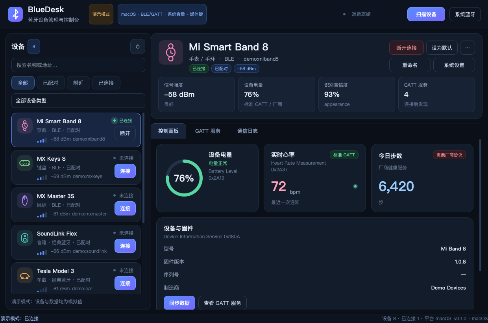
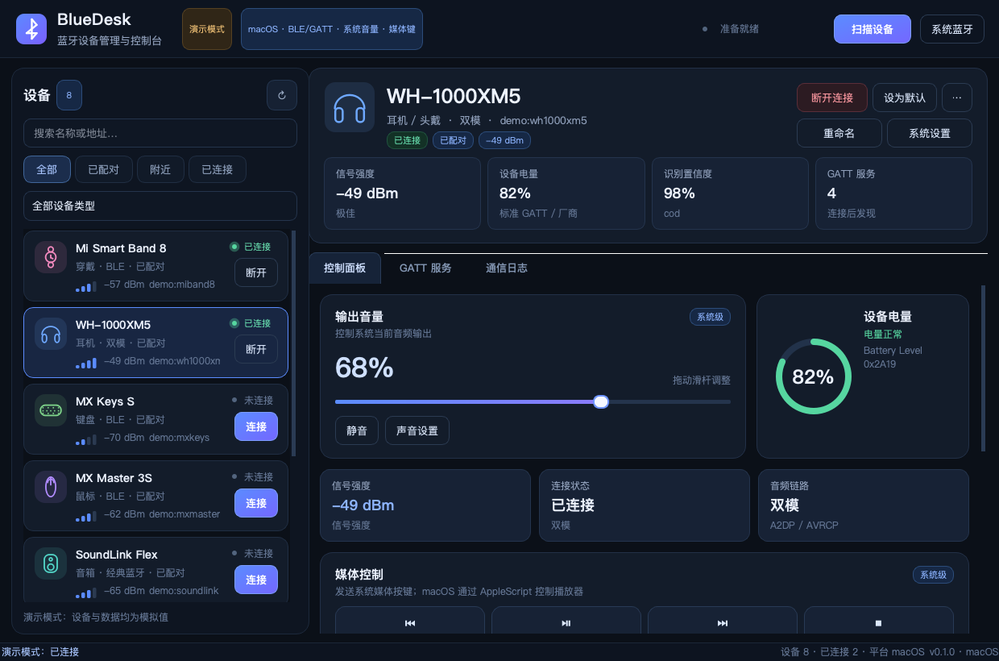
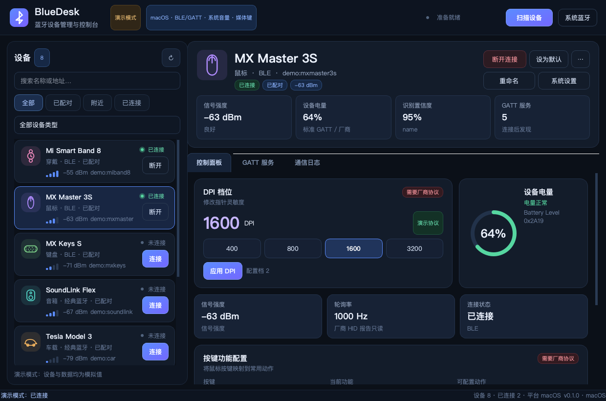
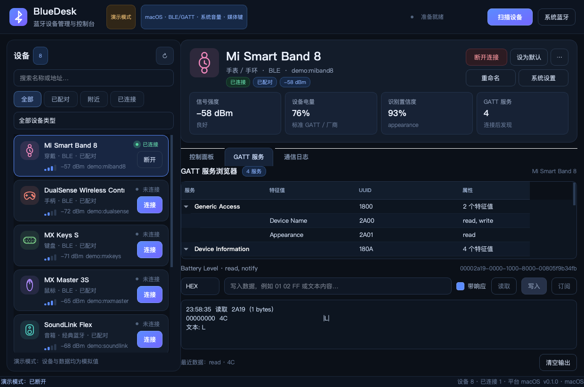
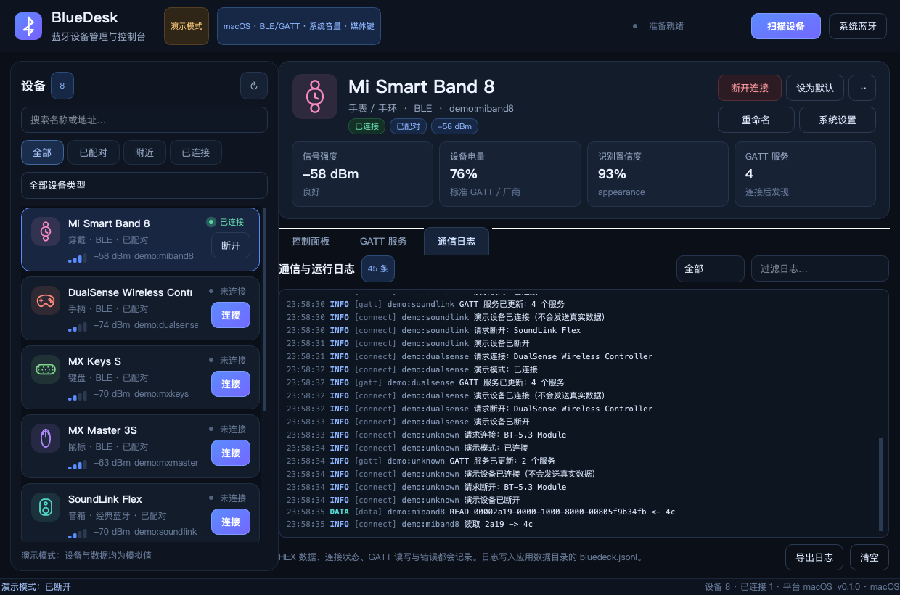
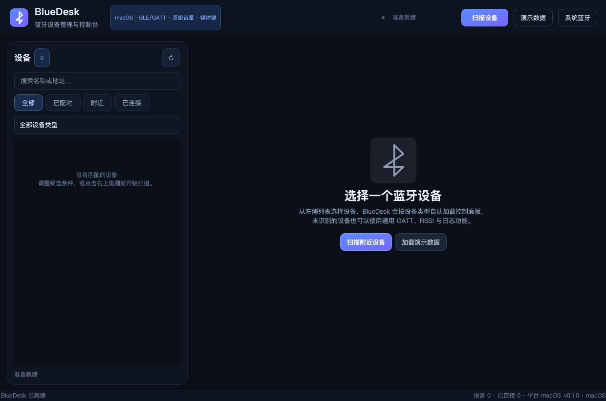

# BlueDesk · 跨平台蓝牙设备管理与控制台

BlueDesk 是一个面向 **Windows 10/11** 与 **macOS** 的桌面蓝牙设备管理工具。它使用 Python 3 + PySide6 构建 UI，使用 Bleak 统一访问 BLE，通过平台适配层处理 Windows PnP、macOS system_profiler/blueutil、系统音量与媒体控制，并按识别出的设备类型自动切换控制面板。

macOS 兼容性说明：Bleak/CoreBluetooth 路径支持 macOS 10.15+；当前开发环境使用 PySide6 6.8（官方面向较新的 macOS）。如果必须在 macOS 10.15 上运行，请使用 PySide6 6.4.x，并在真机验证 UI 与打包产物。

项目不仅是一份设计文档，还包含可运行的完整实现、演示模式、自动化测试与平台差异说明。

---

## 0. 当前实现状态

| 能力 | 状态 | 说明 |
| --- | --- | --- |
| BLE 扫描 / 停止 / 刷新 | 已实现 | Bleak + 专用 asyncio 线程；macOS 已处理 PyObjC 主线程预加载 |
| 经典蓝牙已配对设备枚举 | 已实现 | Windows PowerShell PnP；macOS system_profiler + 可选 blueutil |
| 设备名称 / 地址 / RSSI / 状态 / 类型展示 | 已实现 | 地址在 macOS BLE 上是 CoreBluetooth UUID |
| 已配对 / 附近 / 已连接 / 类型过滤 | 已实现 | 搜索、筛选、类型下拉 |
| 设备类型识别 | 已实现 | CoD、BLE Appearance、Service UUID、系统提示、名称、厂商数据 |
| 按类型自动切换面板 | 已实现 | 耳机/音箱、鼠标、键盘、手柄、手环、通用 |
| 系统音量 / 静音 / 媒体按键 | 已实现 | macOS osascript；Windows pycaw / 媒体虚拟键 |
| BLE GATT 浏览 / 读 / 写 / 通知 | 已实现 | 含 HEX/文本、服务树、数据输出 |
| 标准电量 / 心率 / 固件读取 | 已实现 | Battery 0x2A19、Heart Rate 0x2A37、Device Info 0x180A |
| 日志与 CSV / JSON / TXT 导出 | 已实现 | 内存环形缓冲 + JSONL 持久化 |
| 系统配对 / 断开 | 平台受限 | 打开系统设置；macOS 安装 blueutil 后可直接 connect/disconnect |
| 设备级 EQ / DPI / 背光 / 按键映射 | 需厂商协议 | 提供完整 UI 占位、协议接口和示例数据帧，默认不向未知设备写入 |
| 经典蓝牙 RFCOMM / SPP | 未内置 | PyBluez 兼容性差；保留协议适配接口，推荐 Qt/C# 方案 |
| 固件升级 | 路线图 | 需要厂商 DFU 协议与签名校验 |

> 重要原则：**系统级控制**（音量、媒体键）和**设备级控制**（EQ、DPI、背光、按键映射）不是一回事。前者可以直接调用操作系统，后者通常必须依赖厂商私有协议。BlueDesk 会明确标注“系统级”与“需要厂商协议”，不会假装通用协议可以控制所有硬件。

---

## 1. 产品功能概述

### 1.1 目标用户与场景

- 经常在 Windows / macOS 之间切换蓝牙耳机、鼠标、键盘的用户。
- 需要快速查看设备电量、RSSI、连接状态和 GATT 服务的开发者。
- 需要验证 BLE 特征值读写、通知订阅、HEX 数据收发的硬件/嵌入式工程师。
- 希望在同一界面管理多台蓝牙设备，并快速重连、设置默认设备的高级用户。

### 1.2 核心能力

1. **扫描与枚举**
   - BLE 实时扫描，显示名称、CoreBluetooth UUID / MAC、RSSI、广播服务。
   - 经典蓝牙已配对设备枚举，显示系统配对设备与连接状态。
   - 支持开始、停止、刷新、搜索、已配对/附近/已连接过滤、类型过滤。
2. **设备类型识别**
   - 经典蓝牙：Class of Device、Major/Minor Device Class、Service Class。
   - BLE：Appearance、Service UUID、Manufacturer Data、设备名称。
   - 系统提示：macOS device_minorType、Windows PnP 传输类型。
   - 输出 HEADPHONES、SPEAKER、CAR_AUDIO、MOUSE、KEYBOARD、GAMEPAD、WEARABLE、PHONE、UNKNOWN。
3. **动态控制面板**
   - 耳机/音箱/车载：系统音量、静音、媒体播放控制、EQ 占位、电量、连接状态。
   - 鼠标：DPI 档位、轮询率、按键映射占位、电量、RSSI。
   - 键盘：背光、灯效、按键映射占位、电量、连接状态。
   - 手环/手表：电量、心率、步数、固件、型号。
   - 手柄：电量、按键/摇杆能力说明。
   - 通用设备：连接、重命名、RSSI、GATT 服务、日志。
4. **连接管理**
   - 未连接 / 连接中 / 已连接 / 断开中 / 连接失败状态。
   - BLE 通过 Bleak 建立 GATT 连接；经典蓝牙通过系统设置或 blueutil。
   - 最近设备、默认设备、快速重连、断线回调。
5. **数据通信**
   - GATT 服务树、特征值属性、读取、写入、通知订阅。
   - HEX / UTF-8 文本切换。
   - 所有读写、通知、错误写入日志，可导出。
6. **演示模式**
   - 不需要蓝牙权限即可查看全部面板和交互。
   - 明确标注“演示数据”，不会向真实设备发送数据。

### 1.3 非目标与边界

- 不实现蓝牙协议栈本身；复用操作系统与 Bleak。
- 不绕过厂商认证、配对加密或固件签名。
- 不承诺所有设备都能读取电量。经典蓝牙电量通常需要厂商扩展。
- 不把“系统音量”伪装成“耳机独立音量”。要控制单个音频终结点，需要额外使用 CoreAudio / Windows Audio APIs 并做路由。
- 不默认发送未知 DPI/EQ 数据包。错误指令可能改变设备配置。

---

## 2. 系统架构

### 2.1 分层架构图

~~~mermaid
flowchart TB
    UI[PySide6 UI 层 设备列表 / 动态面板 / GATT / 日志]
    APP[AppController 设备仓库 / 筛选 / 默认设备 / 状态编排]
    SCAN[ScanService Bleak BLE 扫描]
    CONN[ConnectionManager 连接 / 断开 / GATT / 遥测]
    PROTO[ProtocolRegistry 标准能力 / 厂商协议状态]
    PLAT[PlatformAdapter macOS / Windows / Fallback]
    BLE[CoreBluetooth / WinRT]
    CLASSIC[system_profiler / blueutil / PowerShell PnP / WinRT]
    OS[系统音量 / 媒体键 / 系统设置]
    STORE[SettingsStore / LogStore]
    UI --> APP
    APP --> SCAN
    APP --> CONN
    APP --> PROTO
    APP --> PLAT
    APP --> STORE
    SCAN --> BLE
    CONN --> BLE
    PLAT --> CLASSIC
    PLAT --> OS
~~~

### 2.2 线程模型

~~~text
Qt 主线程
  ├── 所有 QWidget / QObject 生命周期
  ├── AppController 信号槽
  ├── 用户交互与面板刷新
  └── macOS 上预加载 PyObjC / CoreBluetooth 模块
        │
        ▼
AsyncRunner 专用线程（daemon）
  ├── asyncio event loop
  ├── BleakScanner.start / stop
  ├── BleakClient.connect / GATT 读写 / notify
  └── 通过 Qt Signal 把结果排队回主线程
        │
        ▼
ThreadPoolExecutor（2-3 线程）
  ├── system_profiler（macOS，可能耗时数秒）
  ├── PowerShell PnP（Windows）
  └── blueutil connect / disconnect
~~~

关键实现细节：

- **macOS 必须在主线程预加载 PyObjC/CoreBluetooth**。Bleak 在实例化 Scanner 时才惰性导入 CoreBluetooth 后端；如果第一次导入发生在 asyncio 工作线程，同时 Qt 的 AppKit 事件循环正在运行，可能死锁。项目在 **scan_service.py** 模块导入阶段完成预加载，之后可在工作线程安全扫描。
- 扫描停止使用 asyncio.Event + 3 秒超时。CoreBluetooth 偶尔会丢失 isScanning KVO 更新，超时后调用底层 stopScan 释放。
- 所有 UI 更新都通过 Signal 回到主线程；后台线程不直接操作 QWidget。
- 系统命令使用 subprocess 且不经过 shell，避免注入；PowerShell 脚本为固定字符串。

### 2.3 设计模式

| 模式 | 位置 | 用途 |
| --- | --- | --- |
| Adapter | platform/macos.py、platform/windows.py | 屏蔽平台差异 |
| Strategy | ui/panels/factory.py | 按 DeviceType 选择控制面板 |
| Registry | protocols/registry.py | 能力矩阵与厂商协议适配器 |
| Observer | Qt Signal/Slot | 扫描、连接、遥测、日志解耦 |
| Repository | AppController._devices | 统一设备身份、合并与过滤 |
| Command | ConnectionManager 读写/通知方法 | 把 UI 动作转成异步操作 |

---

## 3. 模块划分

### 3.1 源码目录

~~~text
src/bluedeck/
├── app.py                    # 入口、参数、QApplication、截图模式
├── __main__.py               # python -m bluedeck
├── controller.py             # AppController：设备仓库与 UI 编排
├── models.py                 # 枚举、DeviceInfo、GATT、Telemetry、LogEntry
├── classifier.py             # 设备类型识别（CoD/Appearance/UUID/名称）
├── scan_service.py           # BLE 扫描与生命周期
├── connection_manager.py     # BLE 连接、GATT、遥测、系统连接
├── async_runner.py           # 专用 asyncio 线程
├── codecs.py                 # HEX/文本、校验、DPI 示例帧、电量/心率解析
├── ble_uuids.py              # 常用服务/特征值名称
├── settings.py               # 设置持久化、JSONL 日志、导出
├── demo.py                   # 演示设备、服务、遥测
├── protocols/
│   ├── base.py               # FeatureStatus / ProtocolAdapter
│   ├── registry.py           # 能力矩阵
│   └── vendor_examples.py    # 示例 DPI / 背光 / EQ 帧（默认不匹配真实设备）
├── platform/
│   ├── base.py               # PlatformAdapter / run_command
│   ├── macos.py              # system_profiler、blueutil、osascript
│   ├── windows.py            # PowerShell PnP、pycaw、媒体键
│   ├── parsers.py            # 纯函数解析器（可测试）
│   └── unsupported.py        # Linux/CI 安全降级
└── ui/
    ├── main_window.py        # 顶栏、侧栏、状态栏、快捷键
    ├── device_list.py        # 设备卡片与筛选
    ├── device_detail.py      # 详情头、Tabs、动态面板装载
    ├── gatt_browser.py       # 服务树、读写、通知、HEX 输出
    ├── log_panel.py          # 日志过滤、导出
    ├── theme.py              # QSS 主题
    ├── icons.py              # QPainter 矢量图标
    ├── widgets.py            # Card / Pill / RSSI / BatteryRing
    └── panels/
        ├── factory.py
        ├── audio.py
        ├── mouse.py
        ├── keyboard.py
        ├── wearable.py
        └── generic.py
~~~

### 3.2 模块职责

| 模块 | 职责 | 关键文件 |
| --- | --- | --- |
| 蓝牙扫描模块 | BLE 扫描、广播解析、停止/重启、错误上报 | scan_service.py |
| 设备类型识别模块 | CoD/Appearance/UUID/名称/厂商数据融合 | classifier.py |
| 连接管理模块 | BLE GATT 连接、断线回调、系统连接、状态机 | connection_manager.py |
| 协议适配模块 | 标准能力状态、厂商协议接口、示例帧 | protocols/ |
| 设备面板模块 | 根据类型创建面板与刷新遥测 | ui/panels/ |
| 数据日志模块 | 环形日志、JSONL、CSV/JSON/TXT 导出 | settings.py |
| UI 层 | 设备列表、详情、GATT、日志、主题 | ui/ |
| 平台适配层 | 配对枚举、系统音量、媒体键、设置跳转 | platform/ |
| 状态编排 | 设备合并、筛选、默认设备、最近设备 | controller.py |

---

## 4. 数据结构定义

### 4.1 枚举

~~~python
class DeviceType(str, Enum):
    HEADPHONES = "headphones"
    SPEAKER = "speaker"
    CAR_AUDIO = "car_audio"
    MOUSE = "mouse"
    KEYBOARD = "keyboard"
    GAMEPAD = "gamepad"
    WEARABLE = "wearable"
    PHONE = "phone"
    UNKNOWN = "unknown"

class Transport(str, Enum):
    BLE = "ble"
    CLASSIC = "classic"
    DUAL = "dual"
    UNKNOWN = "unknown"

class ConnectionState(str, Enum):
    DISCONNECTED = "disconnected"
    CONNECTING = "connecting"
    CONNECTED = "connected"
    DISCONNECTING = "disconnecting"
    FAILED = "failed"
~~~

### 4.2 设备模型

[models.py](src/bluedeck/models.py) 中的 DeviceInfo 是 UI、扫描、连接、持久化共用的唯一设备视图：

~~~python
@dataclass
class DeviceInfo:
    address: str
    name: str = ""
    device_type: DeviceType = DeviceType.UNKNOWN
    transport: Transport = Transport.UNKNOWN
    rssi: Optional[int] = None
    tx_power: Optional[int] = None
    paired: bool = False
    connected: bool = False
    state: ConnectionState = ConnectionState.DISCONNECTED
    class_of_device: Optional[int] = None
    major_device_class: Optional[int] = None
    minor_device_class: Optional[int] = None
    service_class: Optional[int] = None
    ble_appearance: Optional[int] = None
    service_uuids: List[str] = field(default_factory=list)
    manufacturer_data: Dict[int, bytes] = field(default_factory=dict)
    last_seen: float = field(default_factory=time.time)
    platform: str = ""
    source: str = "unknown"
    confidence: float = 0.0
    classification_source: str = ""
    classification_reason: str = ""
    metadata: Dict[str, Any] = field(default_factory=dict)
~~~

关键设计：

- address 是稳定主键。Windows 经典/部分 BLE 设备为 MAC；macOS BLE 为 CoreBluetooth UUID；system_profiler 无地址时生成 macos: 前缀的合成 ID。
- to_dict / from_dict 支持最近设备持久化和日志快照；bytes 字段转为 HEX。
- merge 只在置信度更高时覆盖类型，避免一次弱名称匹配覆盖高置信 CoD。
- transport 冲突时合并为 DUAL。
- 连接状态由 ConnectionManager 信号显式更新，不依赖 merge 推断。

### 4.3 GATT 模型

~~~python
@dataclass
class GattCharacteristicInfo:
    uuid: str
    handle: Optional[int]
    properties: List[str]       # read / write / notify / indicate ...
    description: str

@dataclass
class GattServiceInfo:
    uuid: str
    handle: Optional[int]
    description: str
    characteristics: List[GattCharacteristicInfo]
~~~

### 4.4 遥测与能力

~~~python
@dataclass
class Telemetry:
    battery: Optional[int] = None
    charging: Optional[bool] = None
    heart_rate: Optional[int] = None
    steps: Optional[int] = None
    firmware: str = ""
    model: str = ""
    serial: str = ""
    manufacturer: str = ""
    extra: Dict[str, Any] = field(default_factory=dict)
    updated_at: float = 0.0

@dataclass(frozen=True)
class DeviceCapabilities:
    volume: bool = False
    media_transport: bool = False
    equalizer: bool = False
    dpi: bool = False
    polling_rate: bool = False
    key_mapping: bool = False
    backlight: bool = False
    battery: bool = False
    heart_rate: bool = False
    steps: bool = False
    firmware: bool = False
    gatt_browser: bool = False
    rfcomm: bool = False
    rename: bool = False
    system_pairing: bool = False
~~~

FeatureStatus 进一步区分：

- SYSTEM：系统级能力，如音量、媒体键。
- STANDARD：公开 GATT 标准，如 Battery、Heart Rate、Device Info。
- VENDOR_REQUIRED：需要厂商协议，如 DPI、EQ、背光、按键映射、步数。
- SUPPORTED：已加载匹配的厂商适配器。
- UNAVAILABLE：当前连接方式不支持。

这比简单的布尔值更诚实，也方便 UI 显示“需要厂商协议”。

### 4.5 设置与日志

- 设置文件：应用数据目录 settings.json。
- 日志文件：应用数据目录 bluedeck.jsonl。
- macOS：~/Library/Application Support/BlueDesk
- Windows：%APPDATA%/BlueDesk
- 支持 BLUEDESK_DATA_DIR 环境变量覆盖（测试与便携模式）。
- 写入不可写目录时不会崩溃，内存状态继续工作，并通过 last_error 记录失败原因。

---

## 5. 设备类型识别逻辑

实现：[classifier.py](src/bluedeck/classifier.py)
测试：[test_classifier.py](tests/test_classifier.py)

### 5.1 优先级

~~~text
1. 经典蓝牙 Class of Device（major / minor / service class）
2. BLE Appearance（HID 子类、手表、心率、音频等）
3. Service UUID（HFP/Headset、A2DP/AVRCP、HID、Heart Rate、RSC、Fitness）
4. 系统提示（macOS device_minorType、Windows PnP 传输类型）
5. 设备名称关键词
6. Manufacturer Data（Apple 耳机广播等弱提示）
7. UNKNOWN -> 通用蓝牙设备
~~~

音频族有一个有意的细化规则：A2DP/AVRCP/Appearance 只能说明“音频设备”，不能区分耳机与音箱。此时若名称明确包含 Headphones/Earbuds/Speaker/SoundLink 等，会在音频族内细化，并标记 source 为 appearance+name 或 service+name。

### 5.2 Class of Device

CoD 为 24 位：

~~~text
bit 23..13  Major Service Class
bit 12..8   Major Device Class
bit 7..2    Minor Device Class
bit 1..0    Format Type
~~~

~~~python
def decode_class_of_device(cod: int) -> tuple[int, int, int]:
    cod = int(cod) & 0xFFFFFF
    major = (cod >> 8) & 0x1F
    minor = (cod >> 2) & 0x3F
    service = (cod >> 13) & 0x7FF
    return major, minor, service
~~~

主要映射：

| Major | Minor | 结果 |
| --- | --- | --- |
| 0x04 Audio/Video | 0x01/0x02/0x05/0x0C | HEADPHONES |
| 0x04 Audio/Video | 0x04/0x06/0x08/0x09/0x0A/0x0B | SPEAKER |
| 0x04 Audio/Video | 0x07 | CAR_AUDIO |
| 0x05 Peripheral | 0x10/0x30 | KEYBOARD |
| 0x05 Peripheral | 0x20 | MOUSE |
| 0x05 Peripheral | 0x04/0x08 | GAMEPAD |
| 0x07 Wearable | — | WEARABLE |
| 0x09 Health | — | WEARABLE |
| 0x02 Phone | — | PHONE |

### 5.3 BLE Appearance

| Appearance | 结果 |
| --- | --- |
| 0x03C1 | KEYBOARD |
| 0x03C2 / 0x03C9 | MOUSE |
| 0x03C3 / 0x03C4 | GAMEPAD |
| 0x00C0 / 0x00C1 / 0x00C2 | WEARABLE |
| 0x0340 / 0x0440 / 0x0980 | WEARABLE |
| 0x0840 / 0x0880 / 0x08C0 | SPEAKER（再由名称细分） |
| 0x0040 | PHONE |

### 5.4 Service UUID

| UUID | 结果 |
| --- | --- |
| 0x1108 Headset、0x1112、0x111E Handsfree | HEADPHONES |
| 0x110A/0x110B/0x110D A2DP | SPEAKER（名称可细分） |
| 0x110C/0x110E/0x110F AVRCP | SPEAKER（弱置信度） |
| 0x180D Heart Rate | WEARABLE |
| 0x1814 RSC、0x1816 CSC、0x1818 Cycling Power | WEARABLE |
| 0x1826 Fitness Machine、0x183E Physical Activity | WEARABLE |
| 0x1812 HID | 交给名称/系统提示，避免武断判成鼠标 |

### 5.5 名称与厂商数据

名称规则按“车载 > 鼠标 > 键盘 > 手柄 > 穿戴 > 音箱 > 耳机 > 手机”的顺序匹配，避免 SoundLink 被归类为耳机、MX Keys 被归类为鼠标。

- 支持 LE_ 前缀和 BLE 广播常见的截断名称，例如 LE_WH-1000XM5。
- 覆盖 WH-/WF-/WI-、AirPods、Buds、TWS、QuietComfort、Jabra、HiTune、SoundLink、Revolve、Flip、Charge、MX Master、MX Keys、DualSense、8BitDo、Mi Band、Amazfit、Garmin、Tesla 等。
- Apple 0x004C 的耳机邻近配对广播作为 0.60 置信度的最后兜底。
- 返回 Classification 中包含 confidence、source、reason，UI 会显示识别依据，便于调试误判。

### 5.6 设备合并

- BLE 扫描与系统配对列表在 macOS 上地址类型不同，无法直接按地址合并。
- AppController 会按“大小写不敏感的完整名称”做二级合并；同名设备合并 transport 为 DUAL，保留 BLE UUID 作为主键。
- 如果系统配对设备的名称与 BLE 广播名称不同，可能显示为两个条目。这是 macOS 没有公开 CoreBluetooth UUID 与 MAC 映射导致的平台限制。

---

## 6. 核心流程

### 6.1 BLE 扫描流程

~~~text
用户点击扫描
  → AppController.start_scan()
  → ScanService.start()
  → AsyncRunner.submit(_scan)
  → BleakScanner(detection_callback)
  → 每个广播：分类 + DeviceInfo → device_found 信号
  → AppController 合并设备 + 更新列表
用户点击停止
  → asyncio.Event.set()
  → BleakScanner.stop()（3 秒超时保护）
  → scanning_changed(False)
~~~

- 扫描是持续扫描，不自动停止；适合观察 RSSI 变化。
- 停止后可以重新开始；测试覆盖了停止/重启。
- 扫描错误（蓝牙关闭、权限拒绝、依赖缺失）会写入日志并在顶部状态显示。

### 6.2 连接流程

~~~text
用户点击连接
  → 判定 BLE 或经典
      ├── BLE：BleakClient.connect()
      │     → 服务发现 → GATT 树
      │     → 读取 Battery / Device Info
      │     → 订阅 Heart Rate
      └── 经典：blueutil（macOS，可选）或系统设置
  → state_changed(CONNECTED / FAILED)
  → 面板刷新、最近设备保存
~~~

- BLE 断线回调会清理 client 与服务，状态回到未连接。
- 经典蓝牙不假装建立 GATT；连接成功只代表系统层连接请求成功。
- Windows 通用配对流程没有稳定的 Python API，应用会打开系统设置并由系统完成配对。
- 重命名：BLE 已连接时尝试写 GAP Device Name 0x2A00；系统配对名称通常不会变化。经典设备重命名会提示使用系统设置。

### 6.3 GATT 发现与读写

~~~text
client.connect()
  → client.services
  → GattServiceInfo[]
  → services_ready(address, services)
  → GattBrowser 渲染服务/特征值树
用户选择特征值
  → 读取：client.read_gatt_char(uuid)
  → 写入：client.write_gatt_char(uuid, data, response)
  → 通知：client.start_notify / stop_notify
  → value_received(address, uuid, bytes, source)
  → 日志 + GATT 输出区（HEX dump + 文本）
~~~

安全设计：写入未知特征值前有明确提示；所有写入记录日志；没有自动向真实设备发送厂商 DPI/EQ 数据。

### 6.4 动态面板路由

| DeviceType | 面板 | 主要模块 |
| --- | --- | --- |
| HEADPHONES / SPEAKER / CAR_AUDIO | AudioPanel | 音量、静音、媒体、EQ 占位、电量、RSSI |
| MOUSE | MousePanel | DPI、轮询率、按键映射占位、电量 |
| KEYBOARD | KeyboardPanel | 背光、灯效、按键映射占位、电量 |
| WEARABLE | WearablePanel | 电量、心率、步数、固件、型号 |
| GAMEPAD | GamepadPanel | 电量、HID 能力说明、按键/摇杆占位 |
| UNKNOWN / PHONE | GenericPanel | 连接、设备信息、服务、日志 |

### 6.5 系统配对与最近设备

- 启动时并行加载系统配对设备和最近设备；不阻塞 UI。
- 默认设备保存在 settings.json；启动后自动选中默认设备。
- 连接成功自动加入最近设备。
- 设置默认设备后，设备卡片与详情头部会显示“默认设备”。

---

## 7. Windows 端关键代码实现

完整说明与更多代码：[docs/windows.md](docs/windows.md)

### 7.1 蓝牙初始化与权限

- Windows 10 1809+ / Windows 11。
- BLE 使用 Bleak 的 WinRT 后端；无需管理员权限。
- Win32 桌面 Python 通常不会弹蓝牙隐私授权。若 GATT 访问失败：
  - 检查“设置 > 蓝牙和其他设备”是否开启蓝牙。
  - 检查“设置 > 隐私和安全性 > 蓝牙”。
  - 某些企业策略会禁用无线电或 WinRT 设备枚举。
- 如果打包为 MSIX，需要在清单中声明 bluetooth 能力。
- 经典蓝牙配对通过系统设置完成；应用只负责打开 ms-settings:bluetooth。
- 绝对音量依赖 pycaw + comtypes（可选依赖）。

### 7.2 已配对设备枚举（PowerShell PnP）

实现：[platform/windows.py](src/bluedeck/platform/windows.py)、[platform/parsers.py](src/bluedeck/platform/parsers.py)

~~~python
PS_SCRIPT = (
    "$ErrorActionPreference='SilentlyContinue'; "
    "Get-PnpDevice -Class Bluetooth | "
    "Where-Object { $_.InstanceId -match 'BTH' -and $_.FriendlyName } | "
    "Select-Object FriendlyName,InstanceId,Status,Present | ConvertTo-Json -Depth 3"
)

def paired_devices(self):
    code, out, _ = run_command(
        ["powershell", "-NoProfile", "-NonInteractive", "-Command", PS_SCRIPT],
        timeout=20.0,
    )
    if code != 0 or not out.strip():
        return []
    return [build_paired_device(...) for item in parse_windows_pnp_devices(out)]
~~~

InstanceId 中提取 MAC：

~~~python
_MAC_RE = re.compile(r"(?:DEV_|&)([0-9A-F]{12})(?=[\_&]|$)", re.IGNORECASE)

def extract_mac_from_instance_id(instance_id: str):
    match = _MAC_RE.search(instance_id or "")
    if not match:
        return None
    raw = match.group(1).upper()
    return ":".join(raw[i:i + 2] for i in range(0, 12, 2))
~~~

### 7.3 BLE 扫描与连接

~~~python
from bleak import BleakScanner, BleakClient

def detection(device, advertisement_data):
    info = DeviceInfo(
        address=device.address,
        name=advertisement_data.local_name or device.name or "",
        rssi=advertisement_data.rssi,
        service_uuids=list(advertisement_data.service_uuids),
        manufacturer_data=dict(advertisement_data.manufacturer_data),
        transport=Transport.BLE,
    )
    # 分类 + 更新 UI

scanner = BleakScanner(detection_callback=detection)
await scanner.start()
await scanner.stop()

client = BleakClient(address, disconnected_callback=on_disconnected, timeout=15.0)
await client.connect()
for service in client.services:
    for char in service.characteristics:
        print(service.uuid, char.uuid, char.properties)
~~~

### 7.4 经典蓝牙 RFCOMM / SPP

- PyBluez / pybluez2 在当前 Windows 上兼容性不稳定，且维护有限；BlueDesk 默认不依赖它。
- 如果必须使用 SPP：
  - 使用 Python 的 socket.AF_BLUETOOTH（Windows 支持有限，取决于 Python 构建）。
  - 或使用 32feet.NET / InTheHand.Net.Bluetooth 的 C# 辅助进程。
  - 或使用 Qt Bluetooth 的 QBluetoothSocket（Windows 支持 RFCOMM，但依赖 MSVC 构建的 Qt）。
- 推荐架构：Python UI + 独立 C# RFCOMM 辅助进程，通过本地 HTTP/IPC 通信，避免 Python 蓝牙栈兼容性问题。

C# RFCOMM 示例见 [docs/windows.md](docs/windows.md)。

### 7.5 系统音量（pycaw）

~~~python
from comtypes import CLSCTX_ALL, CoInitialize
from pycaw.pycaw import AudioUtilities, IAudioEndpointVolume

CoInitialize()
speakers = AudioUtilities.GetSpeakers()
interface = speakers.Activate(IAudioEndpointVolume._iid_, CLSCTX_ALL, None)
volume = interface.QueryInterface(IAudioEndpointVolume)

volume.SetMasterVolumeLevelScalar(0.6, None)
current = volume.GetMasterVolumeLevelScalar()
volume.SetMute(1, None)
~~~

未安装 pycaw 时，应用会明确提示，而不是静默失败。

### 7.6 媒体键

~~~python
import ctypes

VK_MEDIA_NEXT_TRACK = 0xB0
VK_MEDIA_PREV_TRACK = 0xB1
VK_MEDIA_STOP = 0xB2
VK_MEDIA_PLAY_PAUSE = 0xB3
KEYEVENTF_KEYUP = 0x0002

def media_key(vk: int) -> None:
    ctypes.windll.user32.keybd_event(vk, 0, 0, 0)
    ctypes.windll.user32.keybd_event(vk, 0, KEYEVENTF_KEYUP, 0)
~~~

媒体键作用于当前系统媒体会话，不针对某个蓝牙设备。

### 7.7 打开系统设置

~~~python
subprocess.run(["cmd", "/c", "start", "", "ms-settings:bluetooth"], timeout=5)
subprocess.run(["cmd", "/c", "start", "", "ms-settings:sound"], timeout=5)
~~~

### 7.8 鼠标 DPI 指令示例

标准 BLE HID 不定义 DPI 写入。以下是**示例协议帧**，不是通用标准：

~~~python
# protocols/vendor_examples.py
# 帧：A5 01 <profile> <dpi lo> <dpi hi> <xor>
def build_dpi_packet(dpi: int, profile: int = 1) -> bytes:
    body = bytes([0xA5, 0x01, profile, dpi & 0xFF, (dpi >> 8) & 0xFF])
    return body + bytes([checksum8_xor(body)])

# 仅在确认厂商特征值后写入：
await client.write_gatt_char(
    "0000ffe1-0000-1000-8000-00805f9b34fb",
    build_dpi_packet(1600, profile=2),
    response=True,
)
~~~

真实设备需要：
- Logitech HID++ 2.0（通常通过 HID 报告，不是 GATT）。
- 厂商 GATT 服务 UUID、命令格式、校验、确认包。
- 设备特定配置档数量与 DPI 范围。

### 7.9 设备列表 UI 渲染

~~~python
# UI 渲染由 Signal 更新，不在扫描线程直接操作 QWidget
def _on_device_found(self, device: DeviceInfo) -> None:
    self._upsert(device)
    self.devices_changed.emit()

# Sidebar 重建卡片
for device in devices:
    card = DeviceCard(device, device.key == selected_key)
    card.selected.connect(self.selection_changed.emit)
    card.action_requested.connect(self.connect_requested.emit)
    self.list_layout.addWidget(card)
~~~

---

## 8. macOS 端关键代码实现

完整说明与更多代码：[docs/macos.md](docs/macos.md)

### 8.1 权限与 Info.plist

macOS 10.15+ 访问蓝牙需要用户授权。打包为 .app 时必须在 Info.plist 中声明：

~~~xml
<key>NSBluetoothAlwaysUsageDescription</key>
<string>BlueDesk 需要访问蓝牙以扫描、连接和管理附近的蓝牙设备。</string>
<key>NSBluetoothPeripheralUsageDescription</key>
<string>BlueDesk 需要访问蓝牙以连接蓝牙外设。</string>
~~~

- 未打包、直接从终端运行时，TCC 权限归属于 Terminal / Python 可执行文件。
- 首次调用 CoreBluetooth 时系统会弹出授权。
- 用户拒绝后，需要到“系统设置 > 隐私与安全性 > 蓝牙”手动开启。
- 沙盒应用需要 com.apple.security.device.bluetooth 权限。
- 媒体控制使用 AppleScript，会触发“自动化”权限；原生媒体键注入还需要“辅助功能”权限。
- 使用 blueutil 时，blueutil 继承调用它的应用/终端的蓝牙权限。

### 8.2 Bleak / CoreBluetooth 初始化与主线程预加载

实现：[scan_service.py](src/bluedeck/scan_service.py)

~~~python
if sys.platform == "darwin" and BLEAK_AVAILABLE:
    try:
        import objc  # 必须在 Qt 主线程完成
        from bleak.backends.corebluetooth import client as _cb_client
        from bleak.backends.corebluetooth import scanner as _cb_scanner
    except Exception:
        pass

scanner = BleakScanner(detection_callback=on_advertisement)
await scanner.start()
~~~

为什么需要预加载：

- Bleak 在实例化 Scanner 时才导入 CoreBluetooth 后端。
- 如果该导入发生在 asyncio 工作线程，同时 Qt 的 AppKit 事件循环已经运行，PyObjC 导入可能死锁。
- 预加载后，工作线程中的扫描与连接可以正常运行。项目在 macOS 上实测发现 30+ 个 BLE 广播。

### 8.3 已配对/已连接设备枚举

macOS 没有公开的经典蓝牙 inquiry/RFCOMM Python API。应用采用两条路径：

1. **system_profiler**

~~~python
code, out, _ = run_command(
    ["system_profiler", "SPBluetoothDataType", "-json"],
    timeout=15.0,
)
for item in parse_system_profiler_bluetooth(out):
    device = build_paired_device(
        name=item["name"],
        address=item["address"],
        minor_type=item.get("minor_type", ""),
        connected=item.get("connected", False),
        platform="macos",
        source="system_profiler",
    )
~~~

解析器兼容旧版 devices_list 和新版 device_connected / device_not_connected 结构，并支持中英文 minorType。

2. **blueutil（可选）**

~~~bash
brew install blueutil
blueutil --paired --format json
blueutil --connect AA:BB:CC:DD:EE:FF
blueutil --disconnect AA:BB:CC:DD:EE:FF
~~~

应用会自动查找 /opt/homebrew/bin/blueutil、/usr/local/bin/blueutil 和 PATH。未安装时，连接操作会打开系统蓝牙设置。

### 8.4 系统音量

~~~applescript
set volume output volume 60
set volume output muted true
output volume of (get volume settings)
~~~

Python：

~~~python
code, out, err = run_command(
    ["osascript", "-e", "set volume output volume 60"],
    timeout=5.0,
)
~~~

这控制当前系统输出音量，不是耳机内部音量。要单独控制某个音频设备，需要使用 CoreAudio（pyobjc）设置默认输出设备或调整设备音量。

### 8.5 媒体控制

~~~applescript
set runningApps to {}
tell application "System Events" to set runningApps to name of every process
if runningApps contains "Spotify" then
    tell application "Spotify" to playpause
else if runningApps contains "Music" then
    tell application "Music" to playpause
else
    error "Spotify/Music 均未运行"
end if
~~~

支持的指令：play_pause、next、previous、stop。使用前会检查 Spotify/Music 是否运行，避免无意启动播放器。

替代方案：
- 原生 Swift 辅助程序，使用 NSEvent.otherEvent 注入 NX_KEYTYPE_PLAY/NX_KEYTYPE_NEXT。
- 需要辅助功能权限，并需要签名/公证。
- 不适合作为默认可选依赖。

### 8.6 经典蓝牙限制与替代

限制：
- CoreBluetooth 只覆盖 BLE，不覆盖经典蓝牙 inquiry、SDP、RFCOMM。
- IOBluetooth 的公开 Python 绑定不可用；PyObjC 对 IOBluetooth 的封装有限且随系统版本变化。
- system_profiler 只列出已配对/已连接设备，不能发现附近未配对经典设备。
- blueutil 可以 connect/disconnect 已配对设备，但不能替代完整 SDP 浏览。

替代方案：
1. Qt Bluetooth：QBluetoothDeviceDiscoveryAgent、QBluetoothSocket；macOS 上经典蓝牙支持有限，BLE 可用。
2. Swift/Objective-C 辅助进程：IOBluetooth + CoreBluetooth，通过 XPC/本地 HTTP 与 Python 通信。
3. 只做系统级音频控制 + BLE 辅助数据，不尝试 RFCOMM。
4. 若产品必须跨平台经典 SPP，建议 C#/WPF（Windows）+ Swift 辅助（macOS），而不是纯 Python。

### 8.7 打包与签名

- 使用 PyInstaller 生成 .app 后，编辑 Info.plist 加入 NSBluetoothAlwaysUsageDescription。
- 使用 codesign 签名，建议开启 hardened runtime。
- 对外分发需要 notarization，否则 Gatekeeper 会拦截。
- 蓝牙权限与签名身份绑定；修改签名后系统可能再次询问权限。

---

## 9. 跨平台 UI 页面结构

### 9.1 页面树

~~~text
MainWindow
├── TopBar
│   ├── Logo / 标题
│   ├── 演示模式 Pill
│   ├── 平台能力 Pill
│   ├── 扫描状态指示灯
│   ├── 扫描 / 停止按钮
│   ├── 演示数据按钮
│   └── 系统蓝牙设置
├── Body（QSplitter）
│   ├── Sidebar
│   │   ├── 设备计数 / 刷新
│   │   ├── 搜索
│   │   ├── 筛选 Chips（全部/已配对/附近/已连接）
│   │   ├── 类型下拉
│   │   ├── 设备卡片列表
│   │   └── 扫描提示
│   └── QStackedWidget
│       ├── EmptyState
│       └── DeviceDetail
│           ├── Header（图标/名称/类型/地址/状态标签/操作）
│           ├── Metrics（RSSI / 电量 / 置信度 / 服务数）
│           └── Tabs
│               ├── 控制面板（动态 Panel）
│               ├── GATT 服务
│               └── 通信日志
└── StatusBar
~~~

### 9.2 设计语言

- 深色底色 #0b1018，卡片 #131c2a，边框 #223047。
- 主色 #5b8cff 到 #7467ff 的渐变。
- 语义色：绿色已连接、琥珀警告、红色失败、粉色穿戴设备。
- 使用 QPainter 绘制设备矢量图标、RSSI 信号条、电量圆环和扫描脉冲点，避免外部图标依赖。
- 设备卡片选中态使用蓝色描边；连接按钮根据状态切换主色/危险色。
- 面板使用统一 Card / SectionHeader / MetricTile 组件，保持跨类型视觉一致。

### 9.3 功能状态提示

每个高级功能卡片右上角都有明确状态：

- “系统级”：音量、媒体控制。
- “标准 GATT”：电量、心率。
- “需要厂商协议”：EQ、DPI、轮询率、按键映射、背光、步数。
- “未加载协议”/“演示协议”：鼠标/键盘面板的协议状态。

没有协议时控件仍展示，但写入/应用按钮被禁用，并提供说明，避免误导。

### 9.4 截图

### 9.5 快捷键

| 快捷键 | 功能 |
| --- | --- |
| Ctrl+R | 开始/停止扫描 |
| Ctrl+F | 聚焦搜索框 |
| Ctrl+D | 加载演示数据 |
| Esc | 停止扫描 |

---

## 10. 权限与兼容性说明

### 10.1 平台支持矩阵

| 项目 | Windows 10/11 | macOS 10.15+（Qt 版本见下方说明） |
| --- | --- | --- |
| BLE 扫描 | Bleak / WinRT | Bleak / CoreBluetooth |
| BLE GATT | 支持 | 支持 |
| 经典设备枚举 | PowerShell PnP；WinRT 可扩展 | system_profiler / blueutil |
| 经典 SPP/RFCOMM | PyBluez 不稳定；建议 C#/Qt 辅助进程 | 无公开 Python API；需 Swift/Qt |
| 系统音量 | pycaw（可选） | osascript |
| 媒体键 | keybd_event | AppleScript；原生注入需辅助功能 |
| 系统配对 | 打开设置 | 打开设置；blueutil 可选 |
| 设备重命名 | 系统设置 | GAP Name（BLE）或系统设置 |
| 蓝牙权限 | 通常无弹窗；隐私设置 | 首次授权 + TCC |

### 10.2 Python 依赖与版本

- Python 3.9+；推荐 3.10–3.12。
- PySide6 >= 6.4。macOS 12+ 可用 6.8.x；macOS 10.15 需要 6.4.x 并在真机验证。
- Bleak >= 0.22。
- Windows 可选：pycaw、comtypes。
- 不依赖 PyBluez。
- 开发依赖：pytest、pytest-asyncio。

### 10.3 PyBluez / pybluez2 评估

| 维度 | 结论 |
| --- | --- |
| Windows | 依赖系统蓝牙栈，Python 版本/wheel 兼容性差，RFCOMM 可用性不稳定 |
| macOS | 基本不可用；没有 CoreBluetooth 经典 inquiry/RFCOMM 桥接 |
| 维护状态 | 长期低维护，issue 多，不建议作为新产品核心依赖 |
| 替代 | Windows：32feet.NET、WinRT、Qt Bluetooth；macOS：Swift IOBluetooth 辅助进程、blueutil（仅连接管理） |

### 10.4 厂商私有协议限制

| 功能 | 标准协议是否覆盖 | 需要的额外信息 |
| --- | --- | --- |
| 音量 | 系统音量可用；设备独立音量通常不开放 | 厂商 GATT/RFCOMM 命令 |
| 播放/暂停/下一首 | 系统媒体键可用 | 一般不需要设备协议 |
| EQ | 否 | 厂商服务 UUID、频段、增益、校验、持久化方式 |
| DPI | 否（BLE HID 不定义） | HID++ 报告或厂商 GATT 命令 |
| 轮询率 | 否 | 厂商 HID 报告/只读寄存器 |
| 按键映射 | 否 | 厂商配置协议，可能涉及 profile 槽位 |
| 背光/灯效 | 否 | 厂商 HID/GATT 命令 |
| 电量 | BLE 标准 Battery 0x2A19 可用；经典蓝牙通常不可用 | 厂商电量扩展 |
| 心率 | BLE Heart Rate 0x2A37 可用 | 需要订阅通知 |
| 步数/睡眠/血氧 | 否 | 厂商健康服务、认证与数据格式 |
| 固件升级 | 否 | 厂商 DFU 协议、签名、断电恢复策略 |

缺少协议文档时，BlueDesk 会：
- 显示“需要厂商协议”或“当前设备暂不支持该功能”。
- 保留控件与布局，但禁用危险写入。
- 在日志中记录原因。
- 允许开发者通过 ProtocolAdapter 接口接入真实协议。

### 10.5 地址与身份限制

- Windows 经典/BLE 通常使用 MAC；macOS BLE 使用 CoreBluetooth UUID。
- BLE 随机地址会变化，不能用 MAC 作为永久身份。
- macOS system_profiler 不一定提供 CoreBluetooth UUID，导致同一设备可能以“系统配对条目”和“BLE 广播条目”出现两次。
- 应用按名称做二级合并，但不能保证 100% 合并。
- 建议未来引入“设备指纹”（名称 + 厂商 ID + 服务集合 + 用户确认）作为持久身份。

### 10.6 音量与媒体控制的真实语义

- 系统音量控制的是当前默认输出设备。
- 媒体键控制当前系统媒体会话。
- 若连接了耳机但系统输出仍在扬声器，调音量不会改变耳机。
- 要精确控制某个蓝牙音频设备，需要：
  - macOS：CoreAudio 枚举 AudioDevice，设置默认输出或调用设备音量属性。
  - Windows：MMDevice API / pycaw 枚举端点，切换默认端点或设置端点音量。
- 这属于后续可扩展项，不属于标准蓝牙 GATT 能力。

### 10.7 安全与稳定性

- 不向未知设备自动发送厂商写指令。
- 写入前由用户选择特征值；GATT 页面有风险提示。
- 日志可能包含设备地址与数据，导出前应提醒用户脱敏。
- 经典蓝牙连接只调用系统/blueutil，不绕过配对。
- 后台线程异常不会直接崩溃 UI；错误写入日志并更新状态。
- 设置/日志目录不可写时应用继续工作，不阻塞启动。

### 10.8 已知限制

1. 经典蓝牙发现与 RFCOMM 不是纯 Python 跨平台能力。
2. Windows 通用配对流程仍需系统设置。
3. macOS 系统配对设备重命名不可用。
4. 设备级 EQ/DPI/背光/按键映射默认不可用。
5. 手柄输入捕获（按键/摇杆实时值）未实现，仅展示能力说明。
6. 当前没有固件升级与多设备并行批量操作。
7. 截图/测试环境使用 offscreen，真实硬件连接需要在目标机器验证。

---

## 11. 后续可扩展功能

### 11.1 近期

- **设备配置文件**：保存设备类型覆盖、厂商协议选择、DPI 档位、EQ 预设。
- **多设备面板**：允许同时固定多个设备，在一个窗口中横向对比。
- **自动重连策略**：按 RSSI/最近使用/默认设备自动尝试连接。
- **设备指纹**：名称 + 厂商 ID + 服务集合 + 用户确认，解决 macOS 双条目与随机地址问题。
- **音频端点选择**：macOS CoreAudio / Windows MMDevice 切换默认输出。
- **日志脱敏**：导出时隐藏地址后 6 位与自定义名称。

### 11.2 协议与硬件

- 厂商协议插件 SDK：按 service UUID / manufacturer ID / HID usage page 匹配。
- Logitech HID++ 2.0、Razer Synapse、键鼠厂商 GATT。
- Sony / Bose / Jabra 耳机 EQ、降噪、固件。
- 小米/华为/Garmin/Fitbit 健康数据同步（需要认证与协议文档）。
- Nordic Secure DFU / 厂商 DFU 固件升级，带签名校验与回滚。
- RFCOMM/SPP Python 桥接：独立 C# 或 Swift 辅助进程。

### 11.3 体验

- 系统托盘与菜单栏快捷控制。
- 全局快捷键：音量、DPI、媒体、一键重连。
- 查找设备：RSSI 趋势 + 距离估算 + 声音提示。
- 自定义控制面板：拖拽卡片、保存布局。
- 设备使用日志与统计：连接时长、断线次数、电量曲线。
- 深色/浅色主题、系统强调色、国际化。
- 移动端伴侣或 WebSocket 远程控制（谨慎处理安全）。

### 11.4 工程化

- PyInstaller / Briefcase 打包 Windows 安装包与 macOS .app。
- CI：单元测试 + offscreen UI 冒烟测试 + 签名产物。
- 蓝牙硬件实验室：多型号耳机/鼠标/手环自动回归。
- 结构化日志与崩溃上报（隐私可选）。
- 插件沙箱与命令白名单。

---

## 12. 运行、测试与打包

### 12.1 安装

macOS / Linux：

~~~bash
cd "Bluetooth Controller"
python3 -m venv .venv
source .venv/bin/activate
python -m pip install --upgrade pip
python -m pip install -e .
python -m bluedeck
~~~

Windows PowerShell：

~~~powershell
cd "Bluetooth Controller"
py -3.11 -m venv .venv
.\.venv\Scripts\Activate.ps1
python -m pip install --upgrade pip
python -m pip install -e .
python -m bluedeck
~~~

可选增强：

~~~bash
# Windows 绝对音量
python -m pip install pycaw comtypes

# macOS 经典设备连接/断开
brew install blueutil
~~~

### 12.2 演示模式

~~~bash
python -m bluedeck --demo
python -m bluedeck --demo --no-scan
~~~

不需要蓝牙权限，启动后自动加载 8 个演示设备并连接第一个。

### 12.3 截图模式

~~~bash
QT_QPA_PLATFORM=offscreen python -m bluedeck --screenshot artifacts/overview.png
~~~

### 12.4 测试

~~~bash
python -m pytest -q
~~~

当前测试覆盖：

- CoD、Appearance、Service UUID、名称、OS 提示、厂商数据分类。
- system_profiler 新旧结构、blueutil、Windows PnP、MAC 提取。
- HEX/文本、校验和、DPI 示例帧、电量/心率解析。
- 设置持久化、不可写目录、日志导出。
- 设备合并、能力矩阵、FeatureStatus。
- offscreen UI 冒烟：8 个演示设备、面板切换、GATT、日志。

### 12.5 数据目录

| 平台 | 路径 |
| --- | --- |
| macOS | ~/Library/Application Support/BlueDesk |
| Windows | %APPDATA%/BlueDesk |
| Linux | ~/.local/share/BlueDesk |
| 覆盖 | BLUEDESK_DATA_DIR=/path |

### 12.6 打包提示

macOS：

~~~bash
python -m pip install pyinstaller
pyinstaller --windowed --name BlueDesk --icon assets/BlueDesk.icns src/bluedeck/__main__.py
# 然后向生成的 .app/Contents/Info.plist 加入 NSBluetoothAlwaysUsageDescription
codesign --deep --force --options runtime --sign "Developer ID Application: ..." dist/BlueDesk.app
~~~

Windows：

~~~powershell
python -m pip install pyinstaller
pyinstaller --noconfirm --windowed --name BlueDesk --icon assets/BlueDesk.ico src/bluedeck/__main__.py
~~~

打包后必须在目标机器重新验证蓝牙权限与 CoreBluetooth 初始化。

---

## 13. 替代实现建议

### 13.1 C# / .NET + WPF

完整方案与代码：[docs/alternatives.md](docs/alternatives.md)

推荐架构：

- Windows：WPF + Windows.Devices.Bluetooth / Windows.Devices.Enumeration / GATT API + 32feet.NET（经典 RFCOMM）。
- macOS：C# 直接访问 CoreBluetooth/IOBluetooth 受 .NET 绑定限制；建议：
  - Avalonia/.NET UI + Swift 辅助进程（CoreBluetooth + IOBluetooth）。
  - 或 Xamarin.Mac / .NET for macOS 绑定（维护成本高）。
- 通过 localhost IPC/JSON-RPC 或 stdin/stdout 传递设备与数据。

优点：Windows 原生体验好、部署成熟、蓝牙 API 稳定。
缺点：macOS 需要桥接，单代码库不彻底。

### 13.2 Qt / C++

完整方案与代码：[docs/alternatives.md](docs/alternatives.md)

路径：

- QBluetoothDeviceDiscoveryAgent 扫描。
- QBluetoothDeviceInfo 获取地址、RSSI、CoD、serviceUuids。
- QLowEnergyController + QLowEnergyService 做 BLE GATT。
- QBluetoothSocket 做 RFCOMM/SPP。
- QBluetoothLocalDevice 获取已配对设备/配对状态。

平台差异：

- Windows：经典与 BLE 支持相对完整，但 RFCOMM 依赖蓝牙栈。
- macOS：BLE 可用；经典 discovery/RFCOMM 受限，Qt 的 macOS 后端能力有限。
- 需要 MSVC 构建 Qt；部署 Qt 运行库与蓝牙权限声明。

---

## 14. 免责声明

BlueDesk 是一个通用的设备管理与调试工具，不是任何硬件厂商的官方软件。厂商私有协议、固件升级、EQ/DPI/背光/按键映射等功能需要得到厂商授权与协议文档。向未知设备发送错误指令可能导致配置异常，请先在演示模式或可恢复设备上验证。

蓝牙是复杂的系统级能力，不同适配器、驱动、系统版本、设备固件都可能产生差异。项目中的平台限制与“需要厂商协议”提示是刻意设计，而不是缺陷隐藏。

---

## 15. 文件索引

- 核心控制器：[controller.py](src/bluedeck/controller.py)
- 设备模型：[models.py](src/bluedeck/models.py)
- 类型识别：[classifier.py](src/bluedeck/classifier.py)
- BLE 扫描：[scan_service.py](src/bluedeck/scan_service.py)
- 连接/GATT：[connection_manager.py](src/bluedeck/connection_manager.py)
- 平台适配：[platform/](src/bluedeck/platform)
- 协议能力：[protocols/](src/bluedeck/protocols)
- 动态面板：[ui/panels/](src/bluedeck/ui/panels)
- 主窗口：[ui/main_window.py](src/bluedeck/ui/main_window.py)
- GATT UI：[ui/gatt_browser.py](src/bluedeck/ui/gatt_browser.py)
- 测试：[tests/](tests)
- Windows 细节：[docs/windows.md](docs/windows.md)
- macOS 细节：[docs/macos.md](docs/macos.md)
- C# / Qt 替代：[docs/alternatives.md](docs/alternatives.md)
